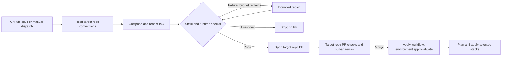

# IaC Smith

Turn a GitHub infrastructure request into a validated Terraform/Terragrunt pull request for human review. IaC Smith reads the target repository's conventions, asks AWS Bedrock for structured infrastructure choices, renders changes, and checks them before opening a PR. The controller never applies infrastructure.

## How it works



1. Label a GitHub issue `iac-smith` (owner-gated in this repo), or dispatch the controller workflow with an issue number and source repository.
2. Inspect the allowlisted target repo, its existing stacks and modules, and the issue's constraints; compose typed resource or registry-module specs.
3. Render Terraform/Terragrunt, run static security checks and backend-free Terraform validation, and repair failures within a fixed budget. Local-state Terragrunt planning runs when `IAC_SMITH_RUNTIME_PLAN=1`, as configured in this repo's controller workflow.
4. Open a PR only if the generation gates pass. The target repo runs separate PR checks; a reviewer still needs to inspect the diff, assumptions, and any plan before merging.
5. A merge starts the target repo's apply workflow. Its environment approval gate controls deployment; controller generation and PR checks do not apply anything.

## End-to-end example

The [VPC foundation request](https://github.com/time4116/iac-smith-showcase-infra/issues/1) produced [PR #3 and its diff](https://github.com/time4116/iac-smith-showcase-infra/pull/3/files) in the public [showcase repository](https://github.com/time4116/iac-smith-showcase-infra). IaC Smith selected a version-pinned `terraform-aws-modules/vpc` call rather than hand-writing every VPC resource; the PR includes backend bootstrap, Terragrunt stack wiring, and generated workflows. The [controller generation run](https://github.com/time4116/iac-smith/actions/runs/28729544715) and PR body record its pre-PR local-state plan and other checks; the [target repo PR check](https://github.com/time4116/iac-smith-showcase-infra/actions/runs/28729578725) is a separate validation job, not a live AWS plan. After merge, the [environment-gated apply run](https://github.com/time4116/iac-smith-showcase-infra/actions/runs/28729633353) completed its approval, backend bootstrap, and VPC apply jobs. Passing a scratch local-state plan did not prove the deployed network would serve a workload: the later [ECS request and PR](https://github.com/time4116/iac-smith-showcase-infra/pull/7) needed a manual networking correction before nginx served traffic; that gap is tracked in [issue #139](https://github.com/time4116/iac-smith/issues/139). The demo infrastructure has since been torn down.

A third [Kinesis/Firehose PR #9](https://github.com/time4116/iac-smith-showcase-infra/pull/9) was merged later, but its [post-merge apply run](https://github.com/time4116/iac-smith-showcase-infra/actions/runs/39637458186) failed at the approval job and did not deploy the pipeline. Its [successful PR CI run](https://github.com/time4116/iac-smith-showcase-infra/actions/runs/39634541542) covered offline tests and backend-free validation, not a live AWS plan. These are distinct outcomes, not evidence of an end-to-end deployment for that third request.

## Prerequisites

- **Two GitHub repositories**: a controller repo (this one) and a target infrastructure repo (new or existing Terraform)
- **AWS account** with Bedrock enabled in your chosen region and model access granted
- **AWS IAM OIDC role** trusted by GitHub Actions (see [docs/SETUP.md](docs/SETUP.md))
- **Python 3.12+** and [uv](https://docs.astral.sh/uv/) (for local development only)

## Quickstart

1. Fork this repo and point it at a target infrastructure repo (empty or existing)
2. Configure the required GitHub Actions secrets and variables (see table below)
3. Create a GitHub issue describing the AWS infrastructure you want
4. Apply the `iac-smith` label to the issue
5. Watch the workflow run and open a PR in the target repo

Include the environment, constraints, existing dependencies, and acceptance criteria in the issue. The controller blocks unsupported or incomplete requests rather than silently treating a scaffold as finished infrastructure.

## Checks you can run without AWS

With Python 3.12+ and `uv`, run the same lint and offline test selection used by controller CI:

```bash
uv sync --locked
uv run ruff check .
uv run ruff format --check .
uv run pytest -m 'not integration and not bedrock'
```

These tests cover parsing, rendering, repository boundaries, invalid specs, security checks, repair behavior, and PR output using fixtures/mocks. They do not prove that a generated stack can deploy in a real AWS account. CI also runs `uv run pytest -m need_binaries -v` with Terraform installed for a foundation validation path; Bedrock integration tests exist but the CI integration job is disabled. Full generation needs Bedrock model access and an AWS role; provider downloads need network access, and an approved target-repo deployment can incur AWS charges (for example NAT gateways, load balancers, ECS, or data services). See [setup](docs/SETUP.md) before enabling a full run.

## Required secrets and variables

Configure these in the controller repo under **Settings → Secrets and variables → Actions**:

| Name | Type | Description |
|---|---|---|
| `AWS_ROLE_ARN_NON_PROD` | Secret | IAM role ARN trusted by GitHub Actions OIDC for Bedrock access and non-prod validation |
| `AWS_ROLE_ARN_PROD` | Secret | IAM role ARN for generated prod validation workflows |
| `IAC_SMITH_TARGET_REPO_PAT` | Secret | Fine-grained PAT scoped only to the target repo with Contents and Pull requests write |
| `BEDROCK_MODEL_ID` | Secret | Bedrock model ID or inference profile ARN (e.g. `anthropic.claude-haiku-4-5-20251001`; verify in the Bedrock console before use) |
| `AWS_REGION` | Variable | AWS region (default: `us-west-2`) |

See [docs/SETUP.md](docs/SETUP.md) for full setup instructions including the IAM trust policy shape and fine-grained PAT scope.

## What IaC Smith can handle

IaC Smith reads the target repo's module layout, version files, and Terragrunt stacks before generating changes. It can reuse existing modules or select provider resources and registry modules from their published schemas; it does not rely on a fixed list of AWS service templates.

It supports both greenfield repos, where the first issue creates the backend bootstrap and repo structure, and iterative additions to existing repos, such as new modules, new stacks, or changes to existing resources.

**IaC Smith generates infrastructure, not application code.** It produces Terraform/Terragrunt, backend bootstrap, CI/apply workflows, and docs; it does not write application source (e.g. a `Program.cs`, a Dockerfile, or a build pipeline), and it is not designed to. A request like "deploy my .NET web app" yields the *infrastructure* to host it (for Elastic Beanstalk, the application and environment; for ECS, the cluster/service/task definition), but the application artifact itself, and the build/deploy step that ships it, is expected to come from a separate application pipeline. Treat the generated infrastructure as the landing zone your app deploys *into*, not as the app.

Before opening a PR, IaC Smith runs:

- **Static review (security tier)**: blocking checks for issues real Terraform may not catch: secret patterns, unsafe file paths, hardcoded Terragrunt state keys, unsafe workflow triggers, and workflow privilege problems
- **Static review (structural tier)**: advisory checks for generated IaC consistency: duplicate declarations, undeclared references, missing required inputs, and dependency-output mismatches. These are surfaced for review and fed into the bounded repair loop, but do not block; the real validator is the gate
- **Runtime validation (correctness gate)**: Terraform formatting, Terragrunt HCL formatting, and backend-free module-level `terraform init` / `terraform validate`, the authoritative check that generated IaC is valid. When optional runtime planning is enabled, IaC Smith also runs plan-only Terragrunt checks against a local-state copy with mocked dependencies (never `apply`), so apply-path errors are caught before a PR is opened
- **Bounded self-repair**: when validation surfaces issues, IaC Smith feeds the exact errors back into the generator, rewrites the affected files, and retries before blocking

Runtime validation is intentionally conservative. IaC Smith never runs `terraform apply`. For new infrastructure where remote state or dependency outputs may not exist yet, validation focuses on formatting, backend-free initialization, and module-level Terraform validation rather than pretending every generated stack can be fully planned.

Requests blocked by the input safety checks or unsupported by the current planner stop without a PR. A successful static check or scratch plan is not a guarantee that the infrastructure will work after deployment.

## Design decisions

| Decision | Why | Trade-off |
|---|---|---|
| Read target repo conventions and existing modules before composing | A change must fit the repository's stacks, versions, and dependencies | Discovery costs time and may still miss undocumented rules; humans review the resulting PR |
| Validate rendered IaC and, when enabled, plan against scratch local state | Model and static review alone cannot catch provider/schema or plan-time errors | A local-state plan with mocked dependencies is not a live AWS plan and cannot prove deployed behavior |
| Limit generation, graph, and runtime repair attempts | The controller must stop when validation does not converge | Some fixable requests will be blocked and require a narrower issue or manual work |
| Stop on missing model/schema contracts, invalid output, or failed blocking checks | A structure-only or unsafe PR would mislead a reviewer | Model/API outages and unsupported requests cause a failed run, not a fallback deployment |
| Keep the controller's AWS OIDC role and target-repo PAT scoped separately | Bedrock/validation access is different from permission to write an IaC PR | Operators must configure both identities and the target repo's own deployment role |
| Require human PR review and a separate target-repo environment approval before apply | Generation is not authorization to change cloud infrastructure | Review and approval are operational controls; enforcement depends on target-repo settings and must be checked by its owner |

A GitHub write failure or unavailable AWS/model service stops the controller; a PR or deployment must not be inferred from a successful earlier phase. The [architecture flow](docs/ARCHITECTURE_FLOW.md) and [setup guide](docs/SETUP.md) cover the boundaries and configuration in more detail.

## Generation modes and local evals

The default generation mode is the typed-spec compiler. IaC Smith builds an `InfrastructureSpec` from parsed intent and the deterministic change plan, then renders repository structure, Terragrunt envelopes, backend bootstrap, workflows, module variables, outputs, and cross-stack dependency wiring from the spec. The previous Bedrock free-form Terraform generator remains available only as an explicit escape hatch with `IAC_SMITH_GENERATION_MODE=freeform`.

The spec renderer validates the spec before rendering so module paths, Terragrunt inputs, dependency outputs, and variables are compiled together instead of repaired after independent per-file generation. When a request depends on infrastructure that does not exist yet (for example a service stack in a repo with no foundation), the change planner blocks with an explicit prerequisite message instead of generating dangling dependency wiring. Existing stack outputs are discovered from the producing module's `outputs.tf` in the target repository, whatever the stack is named.

Module bodies are filled by the spec composer: the model proposes typed resource selections (resource types, arguments, nested blocks) as JSON, never HCL text, and every proposal is validated against the harvested provider schema: hallucinated types, unsupported arguments or blocks, missing required arguments, and references to undeclared variables or non-existent sibling resources are rejected and repaired at the JSON level before anything is rendered. Composition is generic: the candidate universe is whatever `terraform providers schema -json` exposes for the providers the generated files declare. The composer also considers published community modules (the `terraform-aws-modules` namespace by default): candidates are discovered from the Terraform Registry with their input/output contracts harvested the same way provider schemas are, and the model may implement a component as one validated, version-pinned module call instead of reinventing well-solved resources, or decline and compose raw resources. The same schema drives rendering: arguments the provider models as blocks are emitted as HCL blocks at any nesting depth, and proposals that mix up blocks and attributes are canonicalized rather than rejected. When runtime validation or a real `terragrunt plan` fails, the composer re-enters with its previous composition and the exact plan errors and makes the smallest change that addresses them, iterating within the repair budget.

IaC Smith fails closed on legitimacy. When composition is unavailable (no `BEDROCK_MODEL_ID`, `IAC_SMITH_SPEC_COMPOSER=0`, or schema harvest failure), incomplete, or produces no workload resources, the run blocks by default rather than opening a structure-only or misleading PR with placeholder module bodies. `IAC_SMITH_ALLOW_STRUCTURE_ONLY=1` is reserved for explicit offline/eval scenarios where placeholder output is intentional, and even then the PR body carries a prominent warning. Before anything is committed, a final legitimacy gate re-derives the resource inventory from the rendered files and verifies the PR actually contains resources of the requested class with real dependency wiring. PR bodies are generated from that same inventory (including a Scope Monitoring section), so the PR describes what was rendered, not what was intended. Oversized requests beyond `IAC_SMITH_MAX_RESOURCE_TYPES` are rejected with a suggested staged breakdown rather than half-generated.

Use the local eval harness before changing generation behavior:

```bash
uv run python -m iac_smith.eval fixtures/eval/issue-59-aurora.yaml --replay fixtures/eval/replay-issue-59-aurora.yaml --runs 10
```

Omit `--replay` to use live Bedrock intent parsing. Add `--runtime` to run Terraform/Terragrunt validation in a scratch repo, and `--plan` to include local-state Terragrunt plans where credentials and provider access make that feasible. The report tracks intent variants, plan variants, rendered-file hash variants, static-review pass count, Terraform/Terragrunt runtime pass counts, and failure clusters so repeated issue runs can be measured without dispatching the full GitHub Actions workflow.

## Architecture and security model

IaC Smith is split into a controller repository and a target infrastructure repository. The controller repository runs the GitHub Actions workflow, reads the source issue, calls Bedrock, scans the target repository, validates generated Terraform/Terragrunt, and opens a pull request. The target infrastructure repository owns the generated IaC and its normal post-merge apply workflow.

The controller does not apply infrastructure. Its durable safety boundary is PR creation only: generated changes must pass static and runtime checks, then human PR review remains the approval gate before anything is merged or applied.

IaC Smith does not bypass GitOps. It turns an infrastructure request into a bounded, validated pull request with assumptions, warnings, validation results, and an explicit no-apply confirmation in the PR body.

The default public-demo workflow is intentionally narrow. The issue trigger is owner-gated, the target repository is fixed by an allowlist, AWS access is via GitHub Actions OIDC, and target-repo writes use a fine-grained PAT scoped to the target repository rather than broad account credentials.

## Repair limits

The controller uses bounded repair loops at multiple stages:

1. **Generation repair**: security/safety violations and structural issues found by static review are regenerated with the exact errors. A module and its Terragrunt stack are repaired together so their variable contract converges rather than the two files repeatedly undoing each other's changes; if repairs stop making progress, a guard returns best-effort output instead of crashing.
2. **Graph-level repair**: the LangGraph controller can route security-blocking validation back through generation with accumulated context.
3. **Runtime repair**: formatting, backend-free Terraform/Terragrunt validation, and (when `IAC_SMITH_RUNTIME_PLAN` is set) real `terragrunt plan` errors against local state (the authoritative correctness gate) are sent back to the generator for targeted file repair. If the plan cannot be made to pass within the repair budget, IaC Smith blocks rather than opening a PR.

Each repair loop has a retry limit. If a security/safety check or the real Terraform/Terragrunt validation cannot be satisfied, IaC Smith blocks instead of opening a misleading PR. Advisory structural findings that remain are surfaced in the PR body for human review rather than blocking.

## Security checks

IaC Smith runs deterministic checks around the model-generated output before it opens a pull request:

1. **Workflow privilege checks**: controller workflows use least-privilege permissions, pinned third-party actions, locked dependency installs, and an owner-gated workflow trigger before secrets or OIDC credentials are available.
2. **Target boundary checks**: the repository allowlist in `IAC_SMITH_ALLOWED_TARGET_REPO` fails closed so the agent cannot be redirected to an arbitrary repository.
3. **Generated file path checks**: generated paths are resolved under the target repository root before writing, blocking path traversal outside the checkout.
4. **Secret-pattern scan**: generated non-Markdown files are scanned for AWS access keys, private key headers, `aws_access_key_id`, `aws_secret_access_key`, and quoted password/token/secret assignments.
5. **Terraform safety checks**: static review *blocks* on security/safety issues that real Terraform cannot catch: hardcoded Terragrunt state keys, unsafe apply workflow triggers, and workflow privilege problems. Structural findings (duplicate declarations, undeclared references, missing required inputs) are surfaced for review and fed into the repair loop, not blocked. It also flags dangerous public ingress on sensitive ports for reviewer attention.
6. **Terraform/Terragrunt validation**: before committing changes, IaC Smith runs Terraform formatting, Terragrunt HCL formatting, and backend-free module-level Terraform validation. With optional runtime planning enabled, it also runs plan-only Terragrunt checks against local state with mocked dependencies. This is the authoritative correctness gate: failures trigger a bounded repair loop and otherwise block PR creation.
7. **PR disclosure**: generated PR bodies include assumptions, warnings, validation results, backend resources, and an explicit no-apply confirmation.

## Documentation

- [docs/SETUP.md](docs/SETUP.md): full setup guide
- [docs/LAYOUT.md](docs/LAYOUT.md): Terraform/Terragrunt directory layout for greenfield projects
- [AGENT_REFERENCE.md](AGENT_REFERENCE.md): architecture and implementation reference
- [docs/ARCHITECTURE_FLOW.md](docs/ARCHITECTURE_FLOW.md): system architecture flow
- [docs/LANGGRAPH_FLOW.md](docs/LANGGRAPH_FLOW.md): LangGraph/StateGraph controller node flow
- [docs/PROJECT_BRIEF.md](docs/PROJECT_BRIEF.md): current product and portfolio positioning

## License

Apache 2.0; see [LICENSE](LICENSE).
